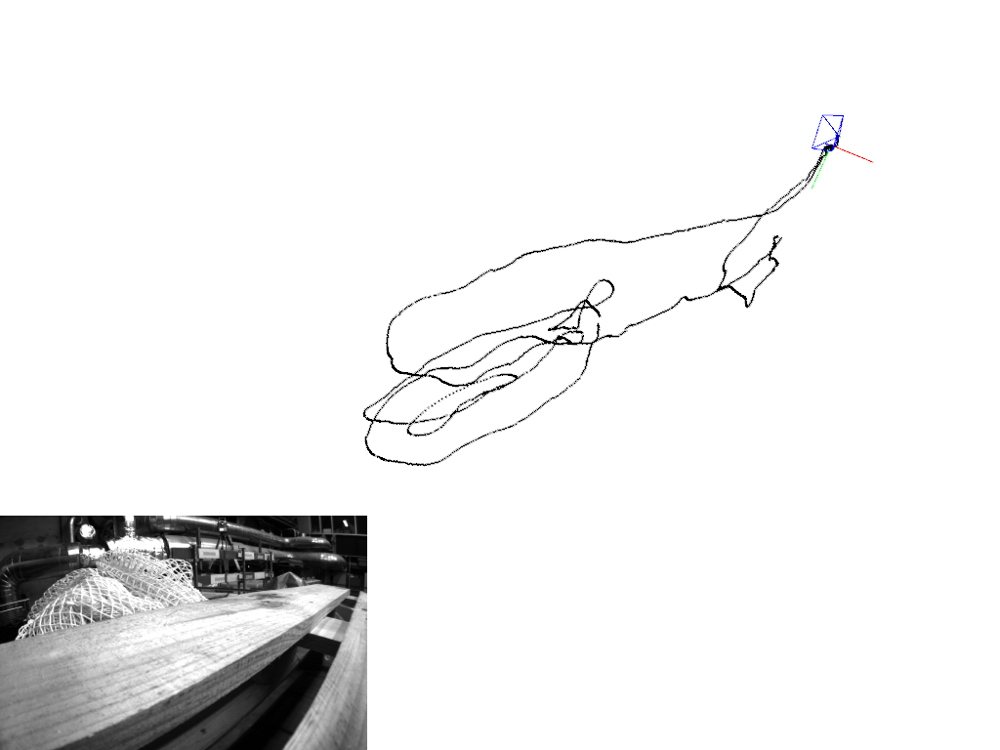

# Stereo MSCKF in Python

The Python stereo MSCKF that the C++ port in [`../cpp`](../cpp) reproduces. It was built for
[WPI's](https://www.wpi.edu/) [RBE/CS549](https://nitinjsanket.github.io/teaching/rbe549/fall2022.html)
(Prof. [Nitin J. Sanket](https://nitinjsanket.github.io/)) on the course's starter code,
modified by [Dr. Lening Li](https://lening.li/). The filter functions (gravity and bias
initialization, IMU processing, process model, state augmentation, measurement update,
pruning) were implemented in this project; the starter code is the first commits.

MSCKF (Multi-State Constraint Kalman Filter) is an EKF-based tightly coupled
visual-inertial odometry algorithm. [S-MSCKF](https://arxiv.org/abs/1712.00036) is its
stereo version. The starter code is translated from the official C++ implementation
[KumarRobotics/msckf_vio](https://github.com/KumarRobotics/msckf_vio).

For algorithm details:
- Ke Sun et al., *Robust Stereo Visual Inertial Odometry for Fast Autonomous Flight* (2017)
- Anastasios I. Mourikis et al., *A Multi-State Constraint Kalman Filter for Vision-aided
  Inertial Navigation* (2006)

How this code behaves on all 11 EuRoC sequences, and the behaviours of it that the C++
port reproduces and then fixes, are in [`../cpp/README.md`](../cpp/README.md).

## Requirements

Python 3.6+, numpy, scipy, opencv-python, matplotlib, and optionally
[pangolin](https://github.com/uoip/pangolin) for the live viewer (`--view`).

```bash
pip install numpy scipy opencv-python matplotlib
```

## Dataset

[EuRoC MAV](http://projects.asl.ethz.ch/datasets/doku.php?id=kmavvisualinertialdatasets):
stereo images, synchronized IMU and ground truth, recorded on board a MAV. The course copy
of MH_01_easy is on [Google Drive](https://drive.google.com/drive/folders/10sMVL7Df9jisSE0bZe9T_aaj9QrB7xNw).

```
MH_01_easy/
└── mav0/
    ├── cam0/data/          # left camera images
    ├── cam1/data/          # right camera images
    ├── imu0/data.csv       # IMU measurements
    └── state_groundtruth_estimate0/data.csv
```

## Run

```bash
cd Code
python vio.py --path /path/to/MH_01_easy           # no visualization
python vio.py --path /path/to/MH_01_easy --view    # live 3-D viewer (pangolin)
```

`vio.py` runs the image, IMU and filter in threads against a wall clock, so two runs give
slightly different results. For a reproducible run, use
[`../cpp/scripts/run_python_reference.py`](../cpp/scripts/run_python_reference.py).

## Outputs

| Location | Contents |
|---|---|
| `output_frames/frame_XXXXX.png` | Per-frame canvas: ground-truth and estimated path, camera frustum, stereo feature inset |
| `plots/1_rotation_error.png` | Roll, pitch and yaw error over time |
| `plots/2_translation_error.png` | x, y and z translation error over time |
| `plots/3a_trajectory_xy.png`, `3b_trajectory_xz.png` | Ground truth vs estimate, top and side view |
| `plots/4_scale_drift.png` | Scale ratio vs distance travelled |
| `plots/5a_rpe_scaramuzza.png` | RPE mean ± std at several segment lengths (Scaramuzza, IROS 2018) |
| `plots/5b_relative_errors_vs_dist.png` | Relative translation (%) and yaw error (deg) vs distance |
| `plots/6_ate_over_time.png` | Absolute trajectory error (Umeyama SE3 alignment) |
| `plots/rmse_report.txt` | RMSE summary: ATE, rotation, scale drift |



## License

Follows the [license of msckf_vio](https://github.com/KumarRobotics/msckf_vio/blob/master/LICENSE.txt).
The code is adapted from [uoip/stereo_msckf](https://github.com/uoip/stereo_msckf).
