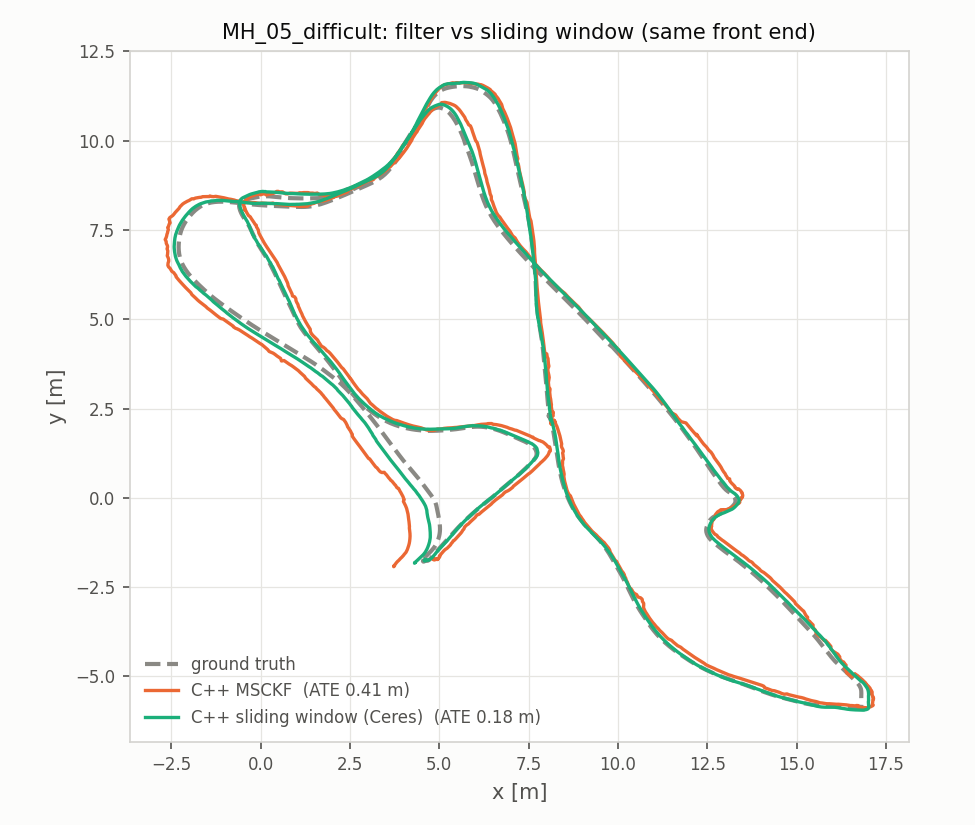

# Stereo Visual-Inertial Odometry: Python → C++17 (MSCKF + Ceres sliding window + ROS 2)

[](https://github.com/Shakthi-Bala/Classical_vio/actions/workflows/cpp.yml)


A stereo MSCKF written in Python, then rebuilt in C++17 and extended:

- **Port checked against the original.** Fed the same features, the C++ filter matches
  the Python to 1e-9 m, and the front end produces identical features on every frame.
- **About 3x faster.** 8.1 ms per frame on one core (6.2x real time) against 25.3 ms for
  the Python on the same node, after profiling with stage timers, a sampling profiler and
  flame graphs.
- **Python quirks measured.** 9 behaviours of the Python code were reproduced on purpose
  and ablated on 11 EuRoC sequences. The fixes that help cut mean trajectory error from
  0.615 to 0.249 m.
- **Ceres sliding-window optimizer** written from scratch: IMU preintegration,
  inverse-depth landmarks, Schur-complement marginalization, analytic Jacobians.
- **Robust to stereo loss.** On V2_03, cam0's long exposure blurs the images, so the
  stereo matches vanish for seconds. Keeping cam0-only tracks takes that sequence from
  0.68 m (and a diverging sliding window) to 0.15–0.20 m.
- **ROS 2 node** whose real-time output matches the offline run, benchmarked against
  VINS-Fusion on the same data and metric. 22 unit tests, run in CI.

| All 11 EuRoC sequences | mean ATE | failures | latency / frame (MH_01) |
|---|---|---|---|
| Python MSCKF | 0.390 m (10 seq.) | 1 (crash) | 25 ms offline, 1 core |
| C++ MSCKF | 0.200 m | 0 | 10.7 ms end to end in ROS 2, 1 core |
| C++ sliding window | 0.156 m | 0 | 19.1 ms end to end in ROS 2, 1 core |
| VINS-Fusion (no loop closure) | 0.217 m | 0 | 61 ms end to end in ROS 2, 4 cores |

<table>
<tr>
<td width="50%" valign="top"><a href="cpp/README.md#final-comparison-11-euroc-sequences"></a><br><b>Accuracy vs latency.</b> The C++ sliding window is the most accurate, the C++ MSCKF matches VINS-Fusion, and both are 3–6x faster per frame.</td>
<td width="50%" valign="top"><a href="cpp/README.md#final-comparison-11-euroc-sequences"></a><br><b>Every EuRoC sequence.</b> Trajectory error per sequence against the Python original and VINS-Fusion.</td>
</tr>
<tr>
<td width="50%" valign="top"><a href="cpp/README.md#cam0-only-features-what-broke-v2_03"></a><br><b>Finding the failure on V2_03.</b> cam0 blurs at long exposure, stereo matching drops to zero for seconds; keeping cam0-only tracks fixed it.</td>
<td width="50%" valign="top"><a href="cpp/README.md#sliding-window-optimizer-ceres-back-end"></a><br><b>Filter vs optimizer.</b> MSCKF and Ceres sliding window on the same front end, MH_05_difficult.</td>
</tr>
<tr>
<td width="50%" valign="top"><a href="cpp/README.md#profiling-and-optimization"></a><br><b>Profiling.</b> Stage timers and flame graphs without perf access: 12.8 → 8.6 ms per frame, output unchanged.</td>
<td width="50%" valign="top"><a href="cpp/README.md#python-quirk-ablation-11-euroc-sequences"></a><br><b>Ablation of inherited quirks.</b> Each behaviour of the Python code tested on 11 sequences; the useful fixes cut error 0.615 → 0.249 m.</td>
</tr>
</table>

**→ Write-up, plots and how to reproduce: [`cpp/README.md`](cpp/README.md)**
· Code: [`cpp/`](cpp) (C++17) · original Python: [`Code/`](Code)

---

## Original Python implementation

### Stereo MSCKF — Visual-Inertial Odometry (Python)


MSCKF (Multi-State Constraint Kalman Filter) is an EKF-based **tightly-coupled**
visual-inertial odometry algorithm.
[S-MSCKF](https://arxiv.org/abs/1712.00036) is its stereo version.
This project is a Python re-implementation translated from the official C++
implementation [KumarRobotics/msckf_vio](https://github.com/KumarRobotics/msckf_vio).

---

## Requirements

```
Python 3.6+
numpy
scipy
opencv-python   (cv2)
matplotlib
pangolin        (optional — only needed for --view)
```

Install the required packages:

```bash
pip install numpy scipy opencv-python matplotlib
```

---

## Dataset

Download the [EuRoC MAV dataset](http://projects.asl.ethz.ch/datasets/doku.php?id=kmavvisualinertialdatasets).
This project has been tested on **MH_01_easy**.

Expected folder structure:

```
MH_01_easy/
└── mav0/
    ├── cam0/data/          # left camera images
    ├── cam1/data/          # right camera images
    ├── imu0/data.csv       # IMU measurements
    └── state_groundtruth_estimate0/data.csv
```

> **Absolute path note:** the default dataset path in `vio.py` is hardcoded to
> `/home/alien/YourDirectoryID_p4/MH_01_easy`.
> Pass `--path` explicitly if your dataset lives elsewhere (see commands below).

---

## Running

### Basic run (no visualisation)

```bash
cd Code
python vio.py
```

### With a custom dataset path

```bash
python vio.py --path /path/to/MH_01_easy
```

### With live 3-D trajectory viewer (requires pangolin)

```bash
python vio.py --view
```

---

## Outputs

| Location | Contents |
|---|---|
| `output_frames/frame_XXXXX.png` | Per-frame canvas: grey GT path, black estimated path, camera frustum, stereo feature inset with GT/EST position text |
| `plots/1_rotation_error.png` | Roll (blue), Pitch (green), Yaw (red) error over time |
| `plots/2_translation_error.png` | X (red), Y (green), Z (blue) translation error over time |
| `plots/3a_trajectory_xy.png` | GT (pink) vs estimated (blue) — top-down X–Y view |
| `plots/3b_trajectory_xz.png` | GT (pink) vs estimated (blue) — X–Z view |
| `plots/4_scale_drift.png` | Scale ratio vs cumulative distance travelled |
| `plots/5a_rpe_scaramuzza.png` | RPE mean ± std at multiple segment lengths (Scaramuzza IROS 2018) |
| `plots/5b_relative_errors_vs_dist.png` | Relative translation (%) and yaw error (deg) vs distance |
| `plots/6_ate_over_time.png` | Absolute Trajectory Error (Umeyama SE3 aligned) |
| `plots/rmse_report.txt` | RMSE summary: ATE, rotation, scale drift |

All plots and the RMSE report are generated automatically at the end of the run.

---

## License

Follows the [license of msckf_vio](https://github.com/KumarRobotics/msckf_vio/blob/master/LICENSE.txt).
Code adapted from [uoip/stereo_msckf](https://github.com/uoip/stereo_msckf).


 ## Dataset link 
 ```bash
https://drive.google.com/drive/folders/10sMVL7Df9jisSE0bZe9T_aaj9QrB7xNw
```
