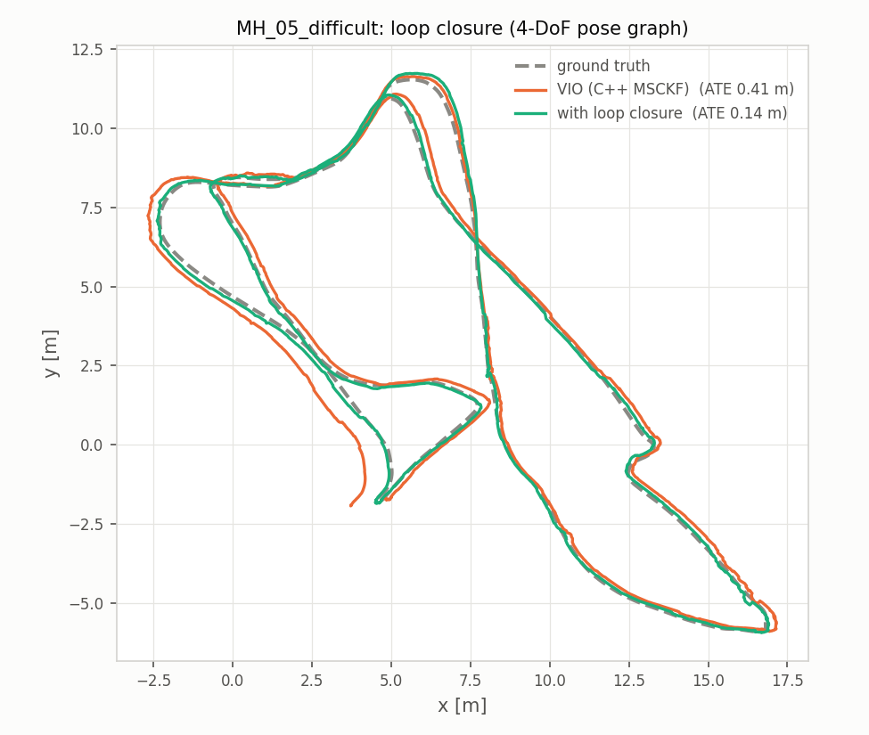

# Stereo Visual-Inertial Odometry: Python → C++17 (MSCKF + Ceres sliding window + ROS 2)

**C++17 · Eigen · Ceres Solver · OpenCV · ROS 2 · CMake · GoogleTest · GitHub Actions · gperftools · Python / NumPy · SLURM**

A stereo MSCKF implemented in Python for a WPI course (RBE/CS549), then rebuilt in C++17
and taken further:

- **Exact port:** the C++ filter matches the Python to 1e-9 m on identical input.
- **3x faster:** 8.1 ms per frame on one core (6.2x real time), against 25.2 ms in Python.
- **Ceres sliding-window optimizer** written from scratch: IMU preintegration,
  marginalization, analytic Jacobians.
- **0 failures on all 11 EuRoC sequences**, after finding and fixing why stereo tracking
  died on the hardest one (V2_03).
- **Beats VINS-Fusion:** the sliding window averages 0.156 m and the MSCKF 0.197 m, against
  0.217 m, at a third and a sixth of its latency per frame in ROS 2.
- **Loop closure** (4-DoF pose graph, ORB + stereo PnP loops): 0.111 m (MSCKF) and 0.105 m
  (sliding window) against 0.132 m for VINS-Fusion with its own loop closure.
- **Second dataset:** on TUM-VI (handheld fisheye) the MSCKF averages 0.129 m with the same
  filter settings.
- **Tested:** 24 unit tests in CI on x86-64 and arm64, a Docker image; the inherited Python
  behaviours were ablated on 11 sequences.

| EuRoC MAV | mean ATE, 10 seq. | mean ATE, all 11 | failures | latency / frame (MH_01) |
|---|---|---|---|---|
| Python MSCKF | 0.390 m | - | 1 (crash) | 25 ms (offline, no ROS node) |
| C++ MSCKF | 0.195 m | 0.197 m | 0 | 10.1 ms end to end in ROS 2, 1 core |
| C++ sliding window | **0.152 m** | **0.156 m** | 0 | 19.1 ms end to end in ROS 2, 1 core |
| VINS-Fusion (no loop closure) | 0.207 m | 0.217 m | 0 | 61 ms end to end in ROS 2, 4 cores |

*ATE: absolute trajectory error after SE3 alignment. "10 seq." are the sequences every
method completes; the Python crashes on V2_03.*

<table>
<tr>
<td width="50%" valign="top"> <b>Accuracy vs latency.</b> The C++ sliding window is the most accurate, the C++ MSCKF slightly ahead of VINS-Fusion, and both are 3–6x faster per frame.</td>
<td width="50%" valign="top"> <b>Every EuRoC sequence.</b> Trajectory error per sequence against the Python original and VINS-Fusion.</td>
</tr>
<tr>
<td width="50%" valign="top"> <b>Finding the failure on V2_03.</b> cam0 blurs at long exposure, stereo matching drops to zero for seconds; keeping cam0-only tracks fixed it.</td>
<td width="50%" valign="top"> <b>Loop closure.</b> 4-DoF pose graph with ORB / stereo PnP loop edges: MH_05 from 0.41 to 0.14 m.</td>
</tr>
<tr>
<td width="50%" valign="top"> <b>Profiling.</b> Stage timers and flame graphs without perf access: 10.4 → 8.1 ms per frame, output unchanged.</td>
<td width="50%" valign="top"> <b>Ablation of inherited quirks.</b> Each behaviour of the Python code tested on 11 sequences; the useful fixes cut error 0.615 → 0.249 m.</td>
</tr>
</table>

**→ Write-up, plots and how to reproduce: [`cpp/README.md`](cpp/README.md)**

| Directory | Contents |
|---|---|
| [`cpp/`](cpp) | C++17 VIO: MSCKF and sliding-window back ends, ROS 2 node, tests, evaluation scripts, results |
| [`Code/`](Code) | the original Python MSCKF ([README](Code/README.md)) |

The Python code builds on the course's starter code, translated from
[KumarRobotics/msckf_vio](https://github.com/KumarRobotics/msckf_vio); it follows the
[msckf_vio license](https://github.com/KumarRobotics/msckf_vio/blob/master/LICENSE.txt).
