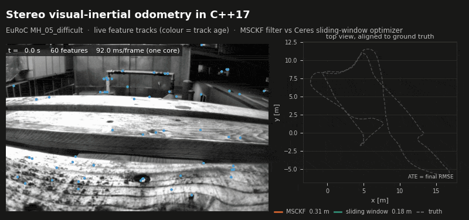
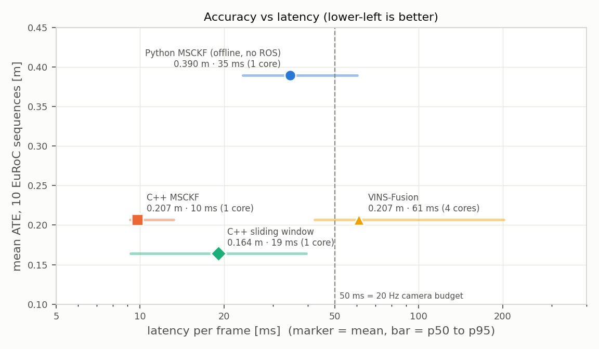
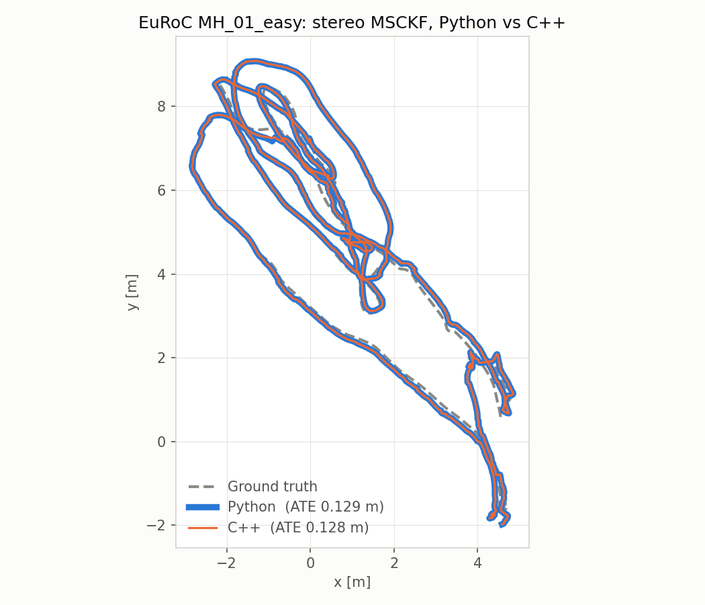
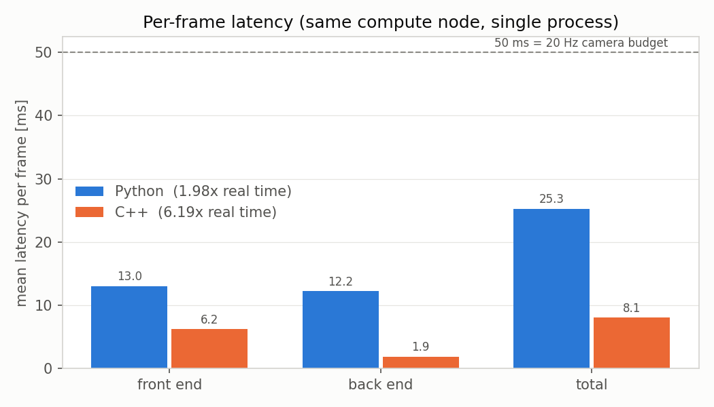
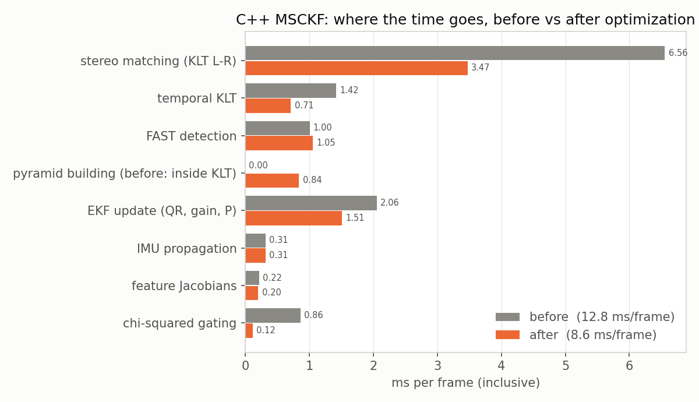
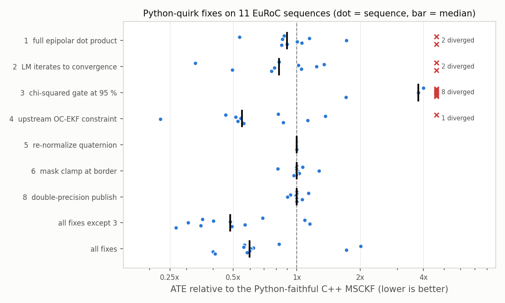
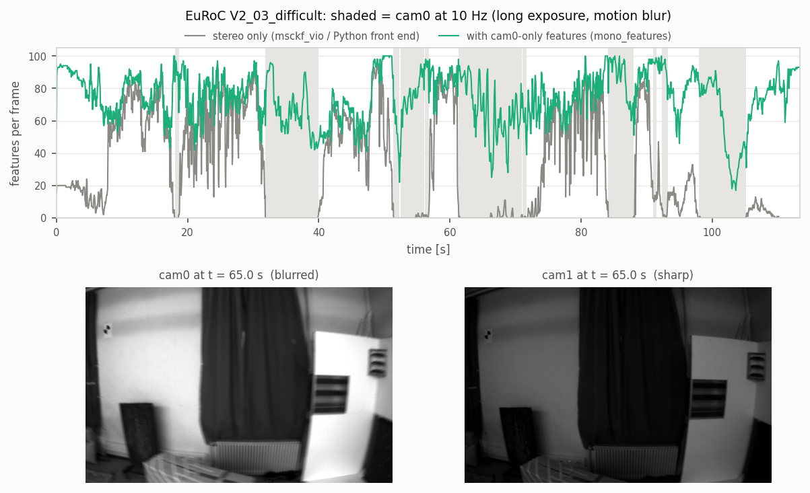
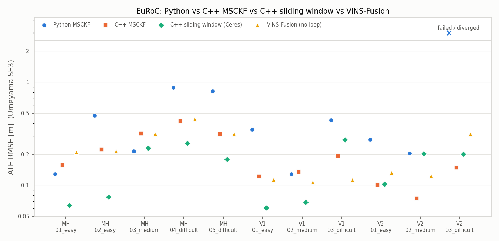

# Stereo visual-inertial odometry in C++17: MSCKF filter and Ceres sliding-window optimizer

[](https://github.com/Shakthi-Bala/Classical_vio/actions/workflows/cpp.yml)



*EuRoC MH_05_difficult at about 8x speed: feature tracks from the front end (left, colour =
track age, contrast-enhanced for display) and both back ends' trajectories against ground
truth (right). Rendered by [`scripts/make_demo_gif.py`](scripts/make_demo_gif.py) from the
runs' own outputs.*

A C++17 / Eigen / OpenCV / Ceres reimplementation of a Python stereo MSCKF
([`../Code`](../Code)). It was checked module by module against the Python, profiled,
and then extended with a sliding-window optimizer, cam0-only features, and a ROS 2 node.
It is benchmarked against VINS-Fusion on all 11 EuRoC sequences. The original plan is in
[ROADMAP.md](ROADMAP.md).

| | Result |
|---|---|
| Port | Fed the same features, the C++ filter matches the Python to 1e-9 m. The front end gives identical features on all 2882 MH_01 frames. |
| Speed | 8.06 ± 0.01 ms per frame on one core (6.2x real time) against 25.2 ± 0.2 ms for the Python, 5 runs on the same node |
| Python quirks | 9 behaviours of the Python code reproduced on purpose, 7 with an opt-in fix. The recommended fixes cut mean ATE from 0.615 to 0.249 m over 11 sequences. |
| Sliding window (Ceres) | IMU preintegration, inverse-depth landmarks, Schur-complement marginalization, analytic Jacobians |
| Cam0-only features | V2_03 lost all stereo matches for up to 7 s. Keeping cam0-only tracks brings it from 0.677 m (MSCKF) and divergence (sliding window) to 0.217 / 0.200 m. |
| ROS 2 node | Real-time bag playback gives the same poses as the offline run (to 4e-9 m, the print precision), at 10.1 ms end to end for the MSCKF |
| vs VINS-Fusion | Mean ATE over all 11 sequences: sliding window 0.156 m, MSCKF 0.197 m, VINS-Fusion 0.217 m. VINS-Fusion is best on V1_03. |
| Loop closure | 4-DoF pose graph with ORB / stereo PnP loops: mean ATE 0.111 m (MSCKF) and 0.105 m (sliding window), against 0.132 m for VINS-Fusion with its loop closure |
| Second dataset | TUM-VI room1–6 (handheld fisheye): MSCKF 0.129 m mean ATE, no failures, with EuRoC's settings |



Sections: [Phase 1 port](#phase-1-python-vs-c-on-euroc-mh_01_easy) ·
[Profiling](#profiling-and-optimization) ·
[Quirk ablation](#python-quirk-ablation-11-euroc-sequences) ·
[Cam0-only features](#cam0-only-features-what-broke-v2_03) ·
[Sliding window](#sliding-window-optimizer-ceres-back-end) · [ROS 2](#ros-2-node) ·
[Final comparison](#final-comparison-11-euroc-sequences) · [Loop closure](#loop-closure) ·
[TUM-VI](#second-dataset-tum-vi) ·
[Build](#build) ·
[Reproduce](#run-and-reproduce) · [Code tour](#code-tour-read-in-this-order) ·
[Quirks](#python-quirks-reproduced-on-purpose)

## Phase 1: Python vs C++ on EuRoC MH_01_easy



Both runs use a 40 s start offset and deterministic replay (no threads), and run one
after the other on the same compute node, compute-3-03
([`scripts/run_timing_job.sh`](scripts/run_timing_job.sh)). Accuracy comes from the
unchanged [`Code/evaluate.py`](../Code/evaluate.py):

| | Python | C++ |
|---|---|---|
| ATE RMSE (Umeyama SE3) | 0.1289 m | 0.1284 m |
| RPE @ 10 m | 1.48 % / 1.41 deg | 1.49 % / 1.39 deg |
| Front end, mean / p95 | 13.03 / 14.19 ms | 6.20 / 7.00 ms |
| Back end, mean / p95 | 12.13 / 28.57 ms | 1.86 / 4.08 ms |
| Total per frame, mean / p95 | 25.16 / 41.75 ms | 8.06 / 10.34 ms |
| Real-time factor | 1.99x | 6.20x |

The C++ runs on one core (`--threads 1`). Over 5 runs the per-frame mean is
25.17 ± 0.16 ms (Python) and 8.06 ± 0.01 ms (C++)
([`results/timing_summary.md`](results/timing_summary.md)). The trajectories are
identical in every run: the replay is deterministic.



Parity:
- **Back end.** Fed the same feature file, the C++ and Python filters agree to 1e-9 m
  (the print precision) on all 2862 poses.
- **Front end.** All 2882 frames give identical features (the same ids, and coordinates
  equal to 1e-6).
- **The remaining 0.5 mm ATE difference** comes from numpy, not from the port. When a
  frame has no new cam0 features, `image.py` hands the filter float32 arrays, and numpy
  1.x keeps `float32_array * float64_scalar` in float32 inside `feature.py`. That ~1e-7
  difference grows along the trajectory, because the filter's gating and pruning
  decisions are sensitive to it.

**Why 0.1289 m and not the 0.1025 m in `plots/rmse_report.txt`?** That number came from
`vio.py`, which runs the image, IMU and filter threads against a wall clock
(`ratio = 0.4`). Which IMU samples a thread has seen when an image arrives depends on
timing, so that run is not reproducible. Both columns here use the same deterministic
replay.

**Where the speed-up comes from.** The front end is mostly OpenCV (FAST, pyramidal LK,
undistortion), which is already C++ under Python, so it gains about 2x, from removing
per-point Python loops. The filter is numpy on small matrices and gains about 6.5x. The
first C++ frame takes about 200 ms (OpenCV start-up); it is included in the statistics.

## Profiling and optimization

`perf` is blocked on the compute nodes (`perf_event_paranoid = 4`, no root), so the
profile comes from two tools that need no privileges:

- **Stage timers.** [`profiler.h`](include/msckf/profiler.h) adds one
  `MSCKF_PROFILE("name")` line per stage; `main_euroc` prints the table and writes
  `profile_stages.csv`.
- **Sampling profiler.** gperftools (`LD_PRELOAD=libprofiler.so`, 1 kHz), converted to a
  flame graph by [`scripts/gperf_to_folded.py`](scripts/gperf_to_folded.py) (addr2line)
  and FlameGraph: [before](results/profile/flame_before.svg),
  [after](results/profile/flame_after.svg).



Before and after were measured on compute-3-03, the node of the tables above. "Before"
is the optimization commit (`b4daaa8`) with its three changes reverted, so only those
differ. The frame time drops from 10.39 to 8.06 ms (4.8x to 6.2x real time), and the
trajectory stays equal to 1e-9 m:

| Change | Why it was slow | Effect (ms per frame) | Output |
|---|---|---|---|
| Build each image pyramid once ([`create_image_pyramids`](src/image_processor.cpp)) | 5 KLT calls per frame each rebuilt both pyramids: 10 builds for 3 images | front end 7.37 -> 6.19 (stereo KLT 5.18 -> 3.77, temporal KLT 1.09 -> 0.76, plus 0.55 for building the pyramids) | bit-identical features and trajectory |
| `P - K (H P)` instead of `(I - K H) P` in [`measurement_update`](src/msckf.cpp) | an extra 141 x 141 x 141 product, and `H P` computed twice | update 1.75 -> 1.23 | trajectory equal to 1e-9 m |
| Gating on the non-zero columns of `H` only ([`gating_test`](src/msckf.cpp)) | `H P H^T` with a 141-wide `H` that is zero outside 2-20 camera blocks | gating 0.74 -> 0.10 | trajectory equal to 1e-9 m |
| `--threads 1` for OpenCV | ~100 points per KLT call are too few to pay for threads | 8.36 (default pool, 4 CPUs) -> 8.06 | identical |

What is left: KLT optical flow (stereo forward and backward, and temporal) is now about
half of a frame. Cutting it further means changing the algorithm (fewer LK iterations, no
backward check), which changes the results.

## Python-quirk ablation (11 EuRoC sequences)

Quirks 1–6 and 8 in the [table at the end](#python-quirks-reproduced-on-purpose) each have
an opt-in fix (`--fix NAME`, or the `fixes:` section of the YAML;
[`config/euroc_fixed.yaml`](config/euroc_fixed.yaml) has the recommended set). All 11
sequences were run with each fix on its own, with all fixes, and with all but the
chi-squared one. Start offsets come from
[`scripts/find_start_offsets.py`](scripts/find_start_offsets.py), which picks the quietest
IMU second before take-off. For MH_01 it picks 40.3 s; we keep `vio.py`'s 40 s.



| ATE RMSE [m] | Python | C++ = Python | C++, all fixes but quirk 3 |
|---|---|---|---|
| MH_01_easy | 0.129 | 0.128 | 0.088 |
| MH_02_easy | 0.472 | 0.576 | 0.205 |
| MH_03_medium | 0.214 | 0.214 | 0.234 |
| MH_04_difficult | 0.880 | 1.030 | 0.415 |
| MH_05_difficult | 0.819 | 0.869 | 0.420 |
| V1_01_easy | 0.346 | 0.384 | 0.117 |
| V1_02_medium | 0.128 | 0.128 | 0.148 |
| V1_03_difficult | 0.429 | 0.429 | 0.244 |
| V2_01_easy | 0.276 | 0.270 | 0.095 |
| V2_02_medium | 0.204 | 0.204 | 0.100 |
| V2_03_difficult | crashes | 2.535 | 0.677 |
| mean (11 seq.) | - | 0.615 | 0.249 |

Full table (every variant): [`results/ablation/ate_table.csv`](results/ablation/ate_table.csv).

What it shows:
- **Quirk 4 (observability constraint) matters most.** The Python OC-EKF projects with
  `R_w_i^T g` and leaves `Phi[0:3,0:3]` alone. On its own, the upstream form roughly
  halves the error on 6 of 11 sequences, but it diverges on V2_03.
- **Quirk 3 is load-bearing.** A 95 % chi-squared gate on its own diverges on 8 of 11
  sequences. With the broken epipolar check (quirk 1) and RANSAC disabled, the over-strict
  5 % gate is what keeps stereo outliers out. Even with every other fix, the strict gate is
  still better (all fixes but quirk 3: 0.249 m; all fixes: 0.359 m).
- **Run-to-run noise.** Quirk 8 only changes rounding (cam0 coordinates in float64 instead
  of float32), yet it moves MH_02 from 0.576 to 0.657 m. Single-sequence differences of
  that size are noise; only consistent wins across sequences count.
- **The Python crashes on V2_03.** A frame with zero tracked features makes `stereo_match`
  return `[]`, which `track_features` cannot unpack. The C++ handles it.
- **Python vs "C++ = Python"** differ on MH_02, MH_04, MH_05, V1_01 and V2_01. This is the
  float32 effect described above, amplified over longer and faster sequences: the same
  algorithm with different rounding.

## Cam0-only features: what broke V2_03



On V2_03 the stereo front end outputs no features at all for 2–7 s at a time (grey line).
The images are not the problem. The two cameras expose independently, and in the dim parts
of the room cam0's exposure grows past 50 ms. cam0 then drops to 10 Hz (shaded) and its
images are motion-blurred, while cam1's stay sharp. LK cannot match a blurred patch to a
sharp one, so every stereo match fails. The front end inherited from msckf_vio drops every
feature without a stereo match, so the back ends get nothing. The MSCKF then coasts on the
IMU (0.677 m), and the sliding window diverges (its speed estimate reaches 6 m/s against a
true 1 m/s). In these frames LK finds no stereo matches even with a 31 x 31 window and 5
pyramid levels, while tracking cam0 against cam0 still works: about 60 % of the corners
track from frame to frame.

With `mono_features: true` ([`config/euroc_mono.yaml`](config/euroc_mono.yaml)):
- **Front end.** A cam0 track without a stereo match is kept, with NaN cam1 coordinates.
  It must track back to its previous position within 1 px, because it has no stereo check
  to catch a bad track. New corners without a match fill grid cells that have too few
  stereo features.
- **MSCKF.** A cam0-only observation adds 2 rows to the feature Jacobian instead of 4.
  A feature with no stereo observation at all is triangulated only after the camera moved
  0.2 m perpendicular to its ray (`mono_min_baseline`). Without that check, V2_01
  diverged.
- **Sliding window.** A landmark without stereo depth is triangulated from its anchor and
  newest keyframe once the rays are 1 degree apart. Its observations have a cam0
  reprojection factor only.

| ATE RMSE [m] | MSCKF stereo only | MSCKF mono | MSCKF mono, prune | SWO stereo only | SWO mono | SWO mono, prune |
|---|---|---|---|---|---|---|
| MH_01_easy | 0.088 | 0.157 | 0.091 | 0.101 | 0.064 | 0.091 |
| MH_02_easy | 0.205 | 0.223 | 0.138 | 0.083 | 0.077 | 0.073 |
| MH_03_medium | 0.234 | 0.318 | 0.225 | 0.215 | 0.230 | 0.199 |
| MH_04_difficult | 0.415 | 0.418 | 0.414 | 0.280 | 0.256 | 0.205 |
| MH_05_difficult | 0.420 | 0.314 | 0.414 | 0.175 | 0.179 | 0.203 |
| V1_01_easy | 0.117 | 0.122 | 0.124 | 0.078 | 0.061 | 0.065 |
| V1_02_medium | 0.148 | 0.135 | 0.165 | 0.082 | 0.069 | 0.094 |
| V1_03_difficult | 0.244 | 0.194 | 0.217 | 0.299 | 0.277 | 0.372 |
| V2_01_easy | 0.095 | 0.101 | 0.077 | 0.117 | 0.102 | 0.115 |
| V2_02_medium | 0.100 | 0.075 | 0.086 | 0.210 | 0.203 | 0.204 |
| V2_03_difficult | 0.677 | 0.149 | 0.217 | div. | 0.200 | 0.192 |
| failures | 0 | 0 | 0 | 1 | 0 | 0 |
| mean, 10 seq. all completed | 0.207 | 0.206 | 0.195 | 0.164 | 0.152 | 0.162 |
| mean, all 11 seq. | 0.249 | 0.200 | 0.197 | - | 0.156 | 0.165 |

"mono" is `config/euroc_mono.yaml`; "prune" (`config/euroc_mono_prune.yaml`) also makes a
full grid cell drop cam0-only features before stereo ones (`mono_prune_first`).

- **Sliding window:** cam0-only features help on 8 of the 10 other sequences as well, and
  the sliding window keeps `euroc_mono.yaml`. Pruning cam0-only features first makes it
  slightly worse (0.165 vs 0.156 m).
- **MSCKF:** plain cam0-only features fix V2_03 but are mixed elsewhere (better on 4 of 10,
  worse on 6, the same mean). The cause is the front end: cam0-only tracks take grid slots
  that stereo features would otherwise keep, and the filter gets depth only from stereo or
  from motion. With pruning it is better than stereo-only on 7 of 10 sequences, and the
  mean drops to 0.195 m (10 sequences) and 0.197 m (all 11). The MSCKF uses
  `euroc_mono_prune.yaml`.
- These settings were chosen on the same 11 sequences they are scored on; there is no
  separate validation set. A third variant for the MSCKF (cam0-only observations only in
  frames with fewer than 30 stereo features) was tried and dropped: better on 7 of 10, but
  the same mean as plain cam0-only features.

## Sliding-window optimizer (Ceres) back end

`main_euroc --backend swo` runs a keyframe-based sliding-window optimizer on the same front
end ([`include/msckf/swo/`](include/msckf/swo), [`src/swo/`](src/swo)):

- **States** per keyframe: position, orientation (Hamilton quaternion with a
  right-perturbation manifold, [`quaternion_manifold.h`](include/msckf/swo/quaternion_manifold.h)),
  velocity, and accelerometer and gyroscope bias. The window holds 10 keyframes.
- **IMU factor.** On-manifold preintegration (Forster et al. 2017) with bias Jacobians for
  first-order bias correction. It is re-integrated when the bias estimate moves far
  ([`imu_preintegration.cpp`](src/swo/imu_preintegration.cpp)).
- **Visual factors.** Landmarks are inverse depths in their anchor keyframe, initialized
  from the stereo pair, or triangulated for cam0-only landmarks. Every observation is a
  reprojection residual per camera, with a Huber loss. The reprojection Jacobians are
  derived by hand ([`ReprojectionFactorAnalytic`](include/msckf/swo/factors.h)); autodiff
  took a third of the solve time.
- **Marginalization.** The oldest keyframe and its landmarks become a Gaussian prior via the
  Schur complement ([`marginalization.cpp`](src/swo/marginalization.cpp)).
- **Keyframes.** A new keyframe is made when parallax exceeds 10 px, when fewer than 50 % of
  the features are still tracked, or after 0.25 s. Other frames report the IMU prediction.

Before the front-end fix, two back-end remedies for V2_03 were tried: restarting the window
after tracking loss, and ignoring vision when few landmarks are usable. Both made it worse
(33.6 m and 15.2 m, against 5.0 m). They were removed; they are in commit `6c3b4e9`.

## ROS 2 node

[`ros2/msckf_vio_ros`](ros2/msckf_vio_ros) wraps either back end as a ROS 2 (Humble) node.
It builds the same library as a CMake subproject, so it runs exactly the code above.

- It subscribes to `/imu0`, `/cam0/image_raw` and `/cam1/image_raw`, and publishes
  `odometry` (twist in the body frame), `path` and the `world -> imu` TF. Parameters:
  `config`, `backend`, `output_dir`, `reliable_qos`, `skip_seconds`, `world_frame`,
  `body_frame`, `opencv_threads`.
- Stereo images are paired by timestamp, and a pair is processed only after every IMU
  sample up to its timestamp. This is the same order as the offline replay, whatever order
  DDS delivers the topics in.
- Played back in real time from the MH_01 ROS 2 bag with the final configurations, the node
  gives the same 2862 poses as `main_euroc`, to 4e-9 m (the print precision): ATE 0.0914 m
  for the MSCKF and 0.0640 m for the sliding window. That needs the same timestamp
  conversion as the offline reader. The node first used `sec + 1e-9 * nanosec`, which
  rounds differently in the last bit, and the filter amplified that to 1.3 cm by the end
  of MH_01.

| MH_01, ROS 2, real-time playback, compute-3-03 | process mean / p95 | end to end mean / p95 |
|---|---|---|
| C++ MSCKF | 9.7 / 13.0 ms | 10.1 / 14.7 ms |
| C++ sliding window | 18.8 / 36.7 ms | 19.1 / 36.8 ms |
| VINS-Fusion (4 cores, its own threads) | - | 61.0 / 202 ms |

End to end runs from the arrival of the later image of a pair to the published odometry,
so it includes DDS delivery and queueing. VINS-Fusion's figure comes from a
`ros2 bag record` of its odometry and the IMU topic during the same kind of run
([`scripts/vins_latency.py`](scripts/vins_latency.py)). It is the pose's receive time minus
the receive time of the IMU sample with the pose's timestamp, so it includes the time
frames wait in VINS-Fusion's internal buffers. On the slower compute-2 nodes VINS-Fusion
falls behind real time: on compute-2-06 the same run needed 390 s after the bag ended. The
run script is [`ros2/run_euroc_bag.sh`](ros2/run_euroc_bag.sh); for the environment, see
[Build](#build).

## Final comparison (11 EuRoC sequences)



"MSCKF" is the C++ filter with [`config/euroc_mono_prune.yaml`](config/euroc_mono_prune.yaml)
and "SWO" the sliding window with [`config/euroc_mono.yaml`](config/euroc_mono.yaml) (quirk
fixes and cam0-only features). "MSCKF = Python" is the C++ with no fix.

| ATE RMSE [m] | Python | MSCKF = Python | MSCKF | SWO | VINS-Fusion |
|---|---|---|---|---|---|
| MH_01_easy | 0.129 | 0.128 | 0.091 | 0.064 | 0.208 |
| MH_02_easy | 0.472 | 0.576 | 0.138 | 0.077 | 0.214 |
| MH_03_medium | 0.214 | 0.214 | 0.225 | 0.230 | 0.313 |
| MH_04_difficult | 0.880 | 1.030 | 0.414 | 0.256 | 0.439 |
| MH_05_difficult | 0.819 | 0.869 | 0.414 | 0.179 | 0.312 |
| V1_01_easy | 0.346 | 0.384 | 0.124 | 0.061 | 0.113 |
| V1_02_medium | 0.128 | 0.128 | 0.165 | 0.069 | 0.107 |
| V1_03_difficult | 0.429 | 0.429 | 0.217 | 0.277 | 0.113 |
| V2_01_easy | 0.276 | 0.270 | 0.077 | 0.102 | 0.131 |
| V2_02_medium | 0.204 | 0.204 | 0.086 | 0.203 | 0.123 |
| V2_03_difficult | fail | 2.535 | 0.217 | 0.200 | 0.313 |
| failures | 1 | 0 | 0 | 0 | 0 |
| mean, 10 seq. all completed | 0.390 | 0.423 | 0.195 | 0.152 | 0.207 |
| mean, all 11 seq. | - | 0.615 | 0.197 | 0.156 | 0.217 |

| RPE @ 10 m [% / deg] | Python | MSCKF = Python | MSCKF | SWO | VINS-Fusion |
|---|---|---|---|---|---|
| MH_01_easy | 1.48 / 1.41 | 1.49 / 1.39 | 1.25 / 1.07 | 0.91 / 0.78 | 2.05 / 0.93 |
| MH_02_easy | 3.37 / 2.91 | 4.58 / 3.04 | 1.66 / 1.01 | 0.64 / 0.55 | 2.19 / 0.91 |
| MH_03_medium | 1.96 / 0.74 | 1.96 / 0.74 | 1.80 / 0.96 | 1.57 / 0.91 | 2.55 / 0.71 |
| MH_04_difficult | 7.50 / 2.88 | 6.80 / 3.25 | 3.03 / 1.05 | 1.93 / 0.88 | 4.30 / 0.89 |
| MH_05_difficult | 2.97 / 1.98 | 3.13 / 2.07 | 2.12 / 0.91 | 1.44 / 0.72 | 3.86 / 0.90 |
| V1_01_easy | 3.51 / 6.89 | 3.56 / 6.19 | 2.33 / 3.42 | 2.29 / 2.96 | 2.65 / 3.01 |
| V1_02_medium | 1.55 / 1.54 | 1.55 / 1.54 | 1.39 / 1.08 | 1.18 / 1.24 | 1.56 / 0.88 |
| V1_03_difficult | 2.89 / 4.34 | 2.89 / 4.34 | 1.61 / 1.37 | 2.07 / 2.06 | 1.33 / 2.59 |
| V2_01_easy | 2.38 / 2.91 | 2.11 / 2.92 | 0.79 / 0.99 | 1.54 / 2.21 | 1.30 / 2.75 |
| V2_02_medium | 1.31 / 2.05 | 1.31 / 2.05 | 0.88 / 1.15 | 1.02 / 1.50 | 1.14 / 2.18 |
| V2_03_difficult | fail | 9.99 / 4.52 | 1.61 / 1.52 | 2.26 / 2.12 | 1.51 / 1.81 |
| mean, 10 seq. all completed | 2.89 / 2.77 | 2.94 / 2.75 | 1.69 / 1.30 | 1.46 / 1.38 | 2.29 / 1.57 |

RPE is the Scaramuzza relative pose error over all 10 m segments (`Code/evaluate.py`'s
`compute_rpe`): translation drift in %, rotation in degrees.

What it shows:
- **The C++ sliding window is the most accurate overall.** Its mean is 0.156 m ATE over all
  11 sequences, against 0.197 m (MSCKF) and 0.217 m (VINS-Fusion). It is best on 7 of 11
  sequences (MH_01, MH_02, MH_04, MH_05, V1_01, V1_02, V2_03).
- **The C++ MSCKF is slightly more accurate than VINS-Fusion** (0.195 vs 0.207 m on the
  first 10 sequences, 0.197 vs 0.217 m on all 11), with lower translation drift (1.69 vs
  2.29 %), at half the sliding window's compute. It is best on V2_01 and V2_02.
- **VINS-Fusion is best on V1_03** (0.113 m against 0.217 m for our best), and the Python
  filter on MH_03.
- **Python -> C++ MSCKF:** 0.390 -> 0.195 m on the 10 sequences both complete, 3x faster,
  and no crash on V2_03.
- **The differences are not run-to-run noise.** The C++ and Python runs are
  deterministic. Three VINS-Fusion runs per sequence gave the same ATE to the millimetre
  on all 11 (single poses differ by up to 2 cm). What a single number does hide is
  sensitivity: a change that only alters rounding (quirk 8) moved MH_02 by 14 %.

VINS-Fusion trajectories, the summary CSV and the patch set applied to the ROS 2 port
([zinuok/VINS-Fusion-ROS2](https://github.com/zinuok/VINS-Fusion-ROS2) @ 72023bc) are in
[`results/vins/`](results/vins). The patches:
- vio.csv timestamps were truncated to whole seconds;
- reliable sensor QoS (best effort lost 902 of 7364 images);
- a single-threaded executor (the port's multi-threaded executor started about 190 threads
  on 192-core nodes and froze);
- a frame-drop switch (off for these runs).

Every run lost 0 messages at rate 1.0.

All runs use deterministic replay, the start offsets in
[`config/euroc_offsets.csv`](config/euroc_offsets.csv), and the same ATE code. VINS-Fusion
(ROS 2 port, stereo + IMU, loop closure off, upstream EuRoC config) runs on the whole bag
and is scored on the same time span as ours.

| MH_01, one core, `--threads 1`, compute-3-03, 5 runs | mean per frame | p95 per frame | real-time factor |
|---|---|---|---|
| Python MSCKF | 25.17 ± 0.16 ms | 41.78 ± 0.33 ms | 1.99x |
| C++ MSCKF, Python behaviour | 8.06 ± 0.01 ms | 10.34 ± 0.00 ms | 6.20x |
| C++ MSCKF | 8.41 ± 0.01 ms | 11.17 ± 0.02 ms | 5.94x |
| C++ sliding window | 17.41 ± 0.06 ms | 35.28 ± 0.14 ms | 2.87x |

## Loop closure

`main_euroc --loop` adds loop closure on top of either back end
([`include/msckf/loop/`](include/msckf/loop), [`src/loop/`](src/loop)). It never feeds back
into the VIO: the VIO trajectory stays byte-identical, and loop closure corrects it.

- **Keyframes** every 0.3 m or 15 degrees: ORB features on cam0, triangulated with cam1
  where a stereo match passes the epipolar check (depth up to 8 m; the baseline is 11 cm).
- **Candidates** are keyframes at least 20 s older, within 4 m of the current corrected
  position and looking the same way. There is no appearance-based place recognition (bag
  of words); this relies on the drift staying below 4 m, which holds on EuRoC.
- **Verification**: ORB matches from the candidate's 3-D points to the current keyframe,
  PnP RANSAC refined with Levenberg-Marquardt, at least 40 inliers, and at most 1 m of
  disagreement with the current pose estimate.
- **4-DoF pose graph** (x, y, z, yaw, as in VINS-Fusion; roll and pitch come from gravity):
  edges to the previous 4 keyframes from the VIO (sigma 2 cm / 0.6 degrees) and loop edges
  (5 cm / 1.1 degrees, Huber loss from 3 sigma), solved with Ceres after each loop.
- **Output**: `traj_loop.txt` corrects each pose with the loops found up to that moment
  (online), `traj_loop_final.txt` corrects every pose with the final graph.

| ATE RMSE [m] | MSCKF | MSCKF loop online | MSCKF loop final | SWO | SWO loop online | SWO loop final | VINS-Fusion | VINS-Fusion loop final |
|---|---|---|---|---|---|---|---|---|
| MH_01_easy | 0.091 | 0.088 | 0.079 | 0.064 | 0.077 | 0.047 | 0.208 | 0.149 |
| MH_02_easy | 0.138 | 0.133 | 0.110 | 0.077 | 0.071 | 0.041 | 0.214 | 0.128 |
| MH_03_medium | 0.225 | 0.124 | 0.101 | 0.230 | 0.119 | 0.115 | 0.313 | 0.124 |
| MH_04_difficult | 0.414 | 0.452 | 0.236 | 0.256 | 0.225 | 0.141 | 0.439 | 0.279 |
| MH_05_difficult | 0.414 | 0.423 | 0.143 | 0.179 | 0.211 | 0.097 | 0.312 | 0.306 |
| V1_01_easy | 0.124 | 0.136 | 0.095 | 0.061 | 0.111 | 0.069 | 0.113 | 0.075 |
| V1_02_medium | 0.165 | 0.116 | 0.092 | 0.069 | 0.096 | 0.088 | 0.107 | 0.064 |
| V1_03_difficult | 0.217 | 0.184 | 0.119 | 0.277 | 0.175 | 0.173 | 0.113 | 0.112 |
| V2_01_easy | 0.077 | 0.072 | 0.052 | 0.102 | 0.094 | 0.053 | 0.131 | 0.050 |
| V2_02_medium | 0.086 | 0.078 | 0.077 | 0.203 | 0.144 | 0.142 | 0.123 | 0.087 |
| V2_03_difficult | 0.217 | 0.137 | 0.117 | 0.200 | 0.247 | 0.193 | 0.313 | 0.083 |
| mean, all 11 | 0.197 | 0.176 | 0.111 | 0.156 | 0.143 | 0.105 | 0.217 | 0.132 |

"Final" for VINS-Fusion is its `vio_loop.csv` after the run: the final pose graph, at
keyframes only. Ours corrects every frame.

- **With loop closure, both C++ back ends are more accurate than VINS-Fusion with its own
  loop closure**: mean ATE 0.111 m (MSCKF) and 0.105 m (sliding window) against 0.132 m.
  The final graph improves on the VIO on 11 of 11 sequences (MSCKF) and 9 of 11 (sliding
  window; V1_01 and V1_02 get slightly worse). VINS-Fusion is best on 4 of 11 (V1_02,
  V1_03, V2_01, V2_03).
- **Online** (each pose corrected as it is published) the gain is smaller: 0.176 m and
  0.143 m. Poses before a loop cannot be corrected after the fact.
- **The comparison is not fully like for like**: our candidates come from pose proximity,
  while VINS-Fusion recognizes places by appearance (DBoW2), which also works after large
  drift or a restart.
- **Cost**: 1.9 ms per frame on average in the same thread as the VIO (p95 15.6 ms,
  max 49 ms when the graph is optimized). About 38 loops per sequence.

How it got there:
- **The first version made things worse** (MH_01 MSCKF 0.091 -> 0.178 m). Each accepted
  loop is written to `loops.csv`, and comparing those relative poses with ground truth
  showed a median translation error of 0.19 m (p90 0.83 m): many wrong loops. Requiring 40
  instead of 25 inliers, refining PnP, dropping stereo points beyond 8 m and the 1 m gate
  brought it to 0.036 m.
- **Equal weights for VIO and loop edges** still let loops pull too hard. Weighting them by
  their expected error fixed that. A synthetic test (`test/test_loop.cpp`: one lap with
  1.7 degrees and ~0.2 m of drift, one loop edge) then showed that a Huber loss from
  1 sigma treats a genuine 4-sigma loop as an outlier and removes only a fifth of the drift.
  From 3 sigma, the loop removes 45 % of the position and 67 % of the yaw drift. On EuRoC the
  two settings give similar means (1 sigma: 0.114 / 0.111 m; 3 sigma: 0.111 / 0.105 m).
- **VINS-Fusion's loop closure was silently broken** in the ROS 2 port. `pubTF` returns
  on its first line, so the camera-IMU extrinsics are never published, `loop_fusion` uses
  a zero rotation, its PnP returns NaN, and no loop is ever accepted (MH_01 0.208 m with
  and without "loop closure"). The patch publishes the extrinsics; it is in
  [`results/vins/vins_patches.diff`](results/vins/vins_patches.diff).

Run with `LOOP=1 scripts/run_backend_job.sh ...`; table:
[`scripts/loop_report.py`](scripts/loop_report.py).

## Second dataset: TUM-VI

Both back ends on the six TUM-VI room sequences (512 x 512 fisheye stereo at 20 Hz,
200 Hz IMU, handheld, motion-capture ground truth over the whole run), with the EuRoC
settings. Only the calibration ([`config/tumvi_mono.yaml`](config/tumvi_mono.yaml)) and the
start offsets change:
- **Start offsets.** [`config/tumvi_offsets.csv`](config/tumvi_offsets.csv) comes from the
  same rule as EuRoC's ([`scripts/find_start_offsets.py`](scripts/find_start_offsets.py)
  `--moved 0.1`): the quietest second before the camera starts to move. A handheld
  camera starts slowly, so "moving" means 0.1 m here instead of a MAV's 1 m take-off.
  With a simpler rule (the quietest gyro second in the first 8 s), room5's static
  initialization overlapped the start of the motion and the MSCKF diverged.
- **Sliding window.** Its pixel settings (noise, Huber, outlier and keyframe thresholds)
  are scaled by the focal length ratio 191 / 458 px, so they mean the same angles as on
  EuRoC. With the EuRoC pixel values its mean ATE was 0.472 m instead of 0.296 m.

| ATE RMSE [m] | C++ MSCKF | C++ sliding window |
|---|---|---|
| room1 | 0.088 | 0.160 |
| room2 | 0.214 | 0.237 |
| room3 | 0.172 | 0.627 |
| room4 | 0.065 | 0.376 |
| room5 | 0.116 | 0.152 |
| room6 | 0.118 | 0.225 |
| mean | 0.129 | 0.296 |

Run with [`scripts/run_tumvi_job.sh`](scripts/run_tumvi_job.sh) (table:
[`results/tumvi/ate.csv`](results/tumvi/ate.csv)). There is no VINS-Fusion baseline here:
its ROS 2 port ships no TUM-VI configuration.

- **The MSCKF carries over well.** It runs all six rooms with EuRoC's filter settings.
- **The sliding window does not**, and is worse than on EuRoC. A likely reason, not yet
  tested: the fisheye images cover about 190 degrees, and its reprojection errors are
  measured on the normalized image plane, which stretches badly towards the border.
- **Open issue.** On room2 the MSCKF diverged in 2 of about 46 runs with the same
  configuration (0.214 m in all others). The two runs agree with the others until frame 5,
  where one measurement update differs. It could not be reproduced on demand: not by
  repeating the arguments, the node, the environment size, or address-space
  randomization. AddressSanitizer and UBSan report nothing, and valgrind cannot run on
  this cluster (no glibc debug symbols). The EuRoC runs have been bit-identical across
  repetitions.

## Build

```bash
conda create -n vio_cpp -c conda-forge --override-channels \
    cxx-compiler "cmake>=3.22" ninja "eigen=3.4" "opencv=4.10" \
    ceres-solver yaml-cpp gtest libboost-devel
conda activate vio_cpp

cd Classical_vio
# Use the env's cmake: an older cmake earlier on PATH (e.g. a pip install in
# ~/.local/bin) cannot configure Ceres' SuiteSparse dependency.
$CONDA_PREFIX/bin/cmake -S cpp -B cpp/build -G Ninja -DCMAKE_BUILD_TYPE=Release
$CONDA_PREFIX/bin/cmake --build cpp/build
ctest --test-dir cpp/build --output-on-failure
```

The 24 unit tests (`test/`) cover:
- `math_utils` (8 tests);
- feature triangulation, including cam0-only observations (4);
- the sliding-window building blocks: manifold, preintegration bias Jacobians, IMU factor,
  marginalization, analytic vs autodiff Jacobians (5);
- both back ends end to end on a synthetic trajectory (5): exact features and an unknown
  accelerometer bias, with stereo and half cam0-only observations. A control test checks
  that the same run without features drifts by more than 1 m;
- the loop-closure pose graph: angle conversions, and one loop edge removing drift (2).

CI ([`.github/workflows/cpp.yml`](../.github/workflows/cpp.yml)) builds with Ubuntu 24.04's
packages and runs the tests on x86-64 and on arm64 (the Jetson's architecture), and builds
the Docker image.

Docker (Ubuntu 24.04; the image build runs the tests):

```bash
docker build -t classical-vio -f cpp/Dockerfile .
docker run --rm -v /path/to/MH_01_easy:/data -v $PWD/out:/out classical-vio \
    --path /data --config config/euroc_mono.yaml --backend swo --out /out
```

ROS 2 node (RoboStack Humble in a conda env, no root needed):

```bash
conda activate ros2_vio          # RoboStack: ros-humble-desktop, colcon, ...
W=/path/to/msckf_ws              # build/install/log outside the repo
cd Classical_vio/cpp
colcon --log-base $W/log build --base-paths ros2 --build-base $W/build \
    --install-base $W/install --cmake-args -DCMAKE_BUILD_TYPE=Release -G Ninja
# node + bag in real time, on a compute node:
MSCKF_WS=$W ROS2_ACTIVATE=/path/to/activate.sh \
  sbatch -p short -c 4 --mem=16G -t 01:00:00 ros2/run_euroc_bag.sh \
    /path/to/MH_01_easy_ros2 swo results/ros2/MH_01_easy_swo 40 config/euroc_mono.yaml
```

## Run and reproduce

```bash
cd Classical_vio/cpp
DATA=/path/to/MH_01_easy

# C++ (front end + back end); --dump-features saves the front-end output
./build/main_euroc --path $DATA --out results/cpp --dump-features
./build/main_euroc --path $DATA --config config/euroc_mono_prune.yaml --out results/msckf
./build/main_euroc --path $DATA --config config/euroc_mono.yaml --backend swo --out results/swo

# Python reference, deterministic (in the Python env)
python scripts/run_python_reference.py --path $DATA --out results/python

# Back-end parity: both filters on the same Python feature file
./build/main_euroc --path $DATA --out results/cpp_replay --features results/python/features_python.txt
python scripts/run_python_reference.py --path $DATA --out results/python_replay \
    --features results/python/features_python.txt

# Timing, all methods one after the other on one compute node; repeat into
# results/timing_repeats/runN, then summarize (results/timing_summary.md)
sbatch -c 2 scripts/run_timing_job.sh $DATA
sbatch -c 2 scripts/run_timing_job.sh $DATA build results/timing_repeats/run1
python scripts/timing_summary.py

# Phase 1 report: results/summary.md, trajectory and latency plots
python scripts/compare.py --seq $DATA
```

All sequences on SLURM (paths in `config/euroc_offsets.csv`):
- `scripts/run_sequence_job.sh`: Python + the ablation variants
  (`scripts/run_ablation.sh`, including all fixes but quirk 3);
- `scripts/run_backend_job.sh BACKEND SEQ OFFSET SEQ_DIR [CONFIG]`: one back end, written
  to `results/backends/BACKEND` for `euroc_fixed.yaml`, else `BACKEND_VARIANT` for
  `euroc_VARIANT.yaml` (e.g. `msckf_mono_prune`).

TUM-VI: download the six `dataset-roomN_512_16` EuRoC-format exports, then
`python scripts/find_start_offsets.py --moved 0.1 .../dataset-room*_512_16 >
config/tumvi_offsets.csv` and `sbatch -c 12 scripts/run_tumvi_job.sh`.

Then the reports and plots:
- `scripts/ablation_table.py` and `scripts/plot_ablation.py`;
- `scripts/final_report.py` (tables and per-sequence plot);
- `scripts/plot_overview.py` (accuracy vs latency);
- `scripts/plot_v203.py` (the figure above);
- `scripts/make_demo_gif.py` (the GIF; its docstring has the exact command).

## Code tour (read in this order)

| File | Python | What to look at |
|---|---|---|
| [math_utils](include/msckf/math_utils.h) | `utils.py` | JPL quaternions as `Eigen::Vector4d`; header vs source; `const&` |
| [config](include/msckf/config.h) + [euroc.yaml](config/euroc.yaml) | `config.py` | structs with default values; yaml-cpp; a small template (`read_matrix`); variants include a `base:` file |
| [messages](include/msckf/messages.h), [state](include/msckf/state.h) | namedtuples, `IMUState`, `CAMState` | `std::map` instead of `dict`, and why the order matters |
| [dataset](src/dataset.cpp) | `dataset.py` | `std::filesystem`, file parsing, int64 ns timestamps, stereo pairing by timestamp |
| [feature](src/feature.cpp) | `feature.py` | `inline static` class members; structured bindings `for (auto& [id, m] : ...)` |
| [msckf](src/msckf.cpp) | `msckf.py` | fixed-size vs dynamic Eigen matrices; `conservativeResize`; thin QR; `ldlt().solve` instead of inverses; aliasing (`symmetrize`, `.eval()`) |
| [image_processor](src/image_processor.cpp) | `image.py` | OpenCV C++ API; a member template (`stereo_match<PointT>`) that mirrors numpy's float32/float64 choice |
| [main_euroc](src/main_euroc.cpp) | `vio.py` | `std::optional`, `std::chrono::steady_clock` timing |
| [loop/](src/loop) | - | Ceres `AutoDiffCostFunction` with a templated residual; OpenCV ORB and PnP |
| [test/](test/) | `Code/test/` | gtest: `TEST`, `EXPECT_NEAR`, seeded random numbers, a synthetic world |

## Python quirks reproduced on purpose

Phase 1 aimed at parity, so these behaviours of the Python code are copied. Each is marked
`NOTE (Python parity)` in the source.

| # | Where | Python behaviour | Upstream msckf_vio | Fix |
|---|---|---|---|---|
| 1 | `image.py` `stereo_match` | epipolar error uses `(pt1 * line)[0]`, one term of the dot product | full dot product `pt1 . line` | `epipolar_full_dot` |
| 2 | `feature.py` `initialize_position` | `is_cost_reduced` never reset: LM accepts one step, then stops updating | do-while loops, iterates to convergence | `lm_upstream_loops` |
| 3 | `msckf.py` `__init__` | `chi2.ppf(0.05, dof)`: 5th percentile gate (the comment says 95 %) | same quirk | `chi2_95` |
| 4 | `msckf.py` `process_model` | OC-EKF uses `u = R_w_i^T g` (pre-propagation orientation), leaves `Phi[0:3,0:3]` | `u = R(q_null) g`, sets `Phi[0:3,0:3]` | `oc_upstream` |
| 5 | `msckf.py` `predict_new_state` | quaternion not re-normalized; small-gyro branch would raise (`ndarray @ scalar`) | normalizes; working branch (used here) | `normalize_quaternion` |
| 6 | `image.py` `add_new_features` | `mask[y-3:y+4, x-3:x+4]` with a negative start selects nothing near the top/left border | clamps | `mask_clamp` |
| 7 | `dataset.py` | start time = first IMU sample + offset (`stereo.start_time()` is still `-inf`) | n/a | none (kept) |
| 8 | `image.py` `publish` | cam0 coordinates float64 if any new feature is present, else float32 | n/a | `full_precision_publish` |
| 9 | `feature.py` `jacobian` | Huber weight `eps / (2 e)` | `sqrt(2 eps / e)` | none (not ablated) |

Not reproduced: the Python `map_server` dict iterates in insertion order and the C++
`std::map` in ID order. That can only matter when an update hits the 1500-row cap, and the
exact back-end parity above shows it never did on MH_01.
